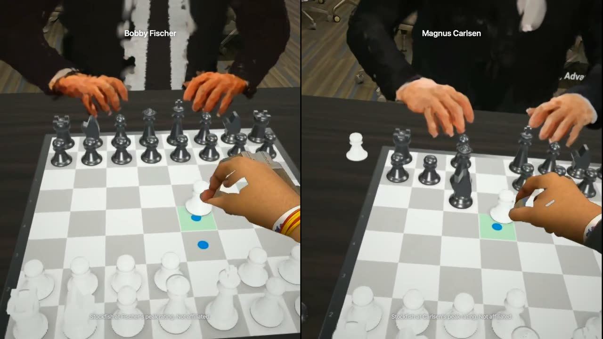
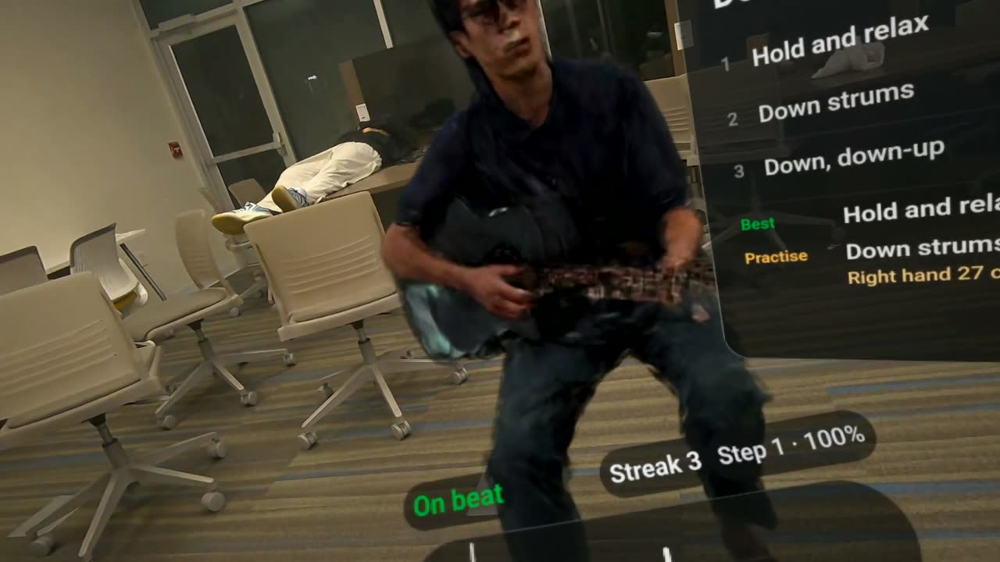
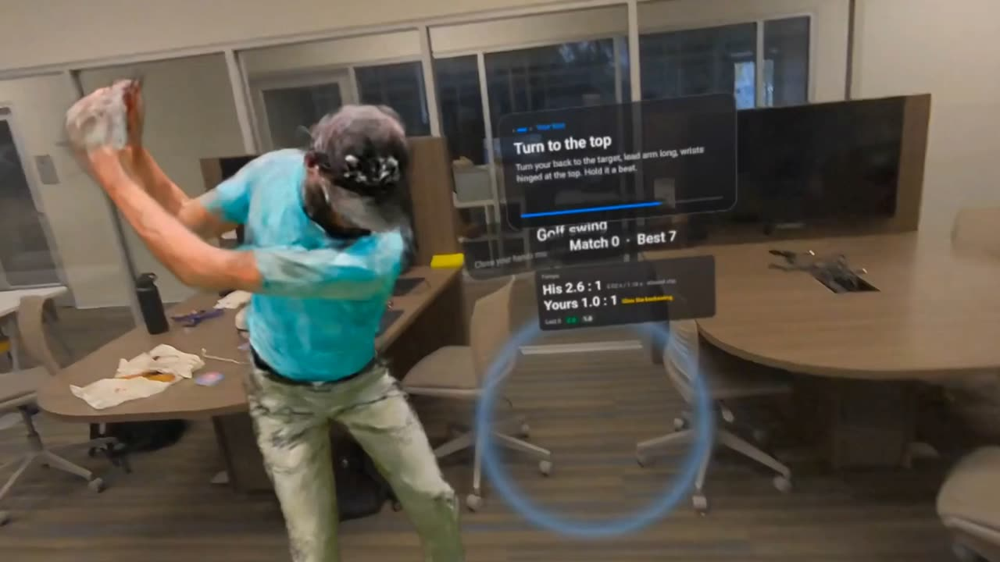
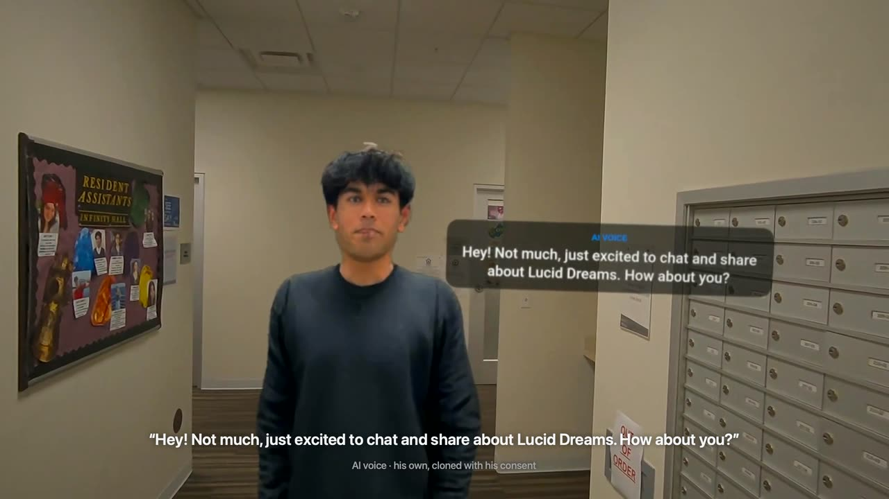
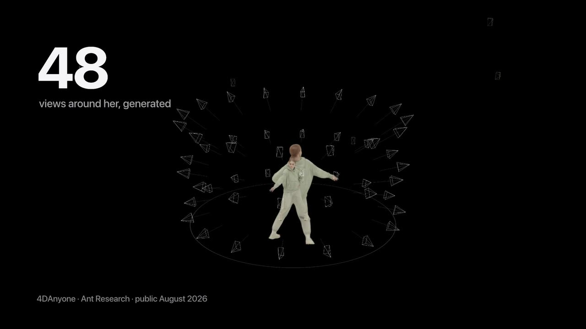
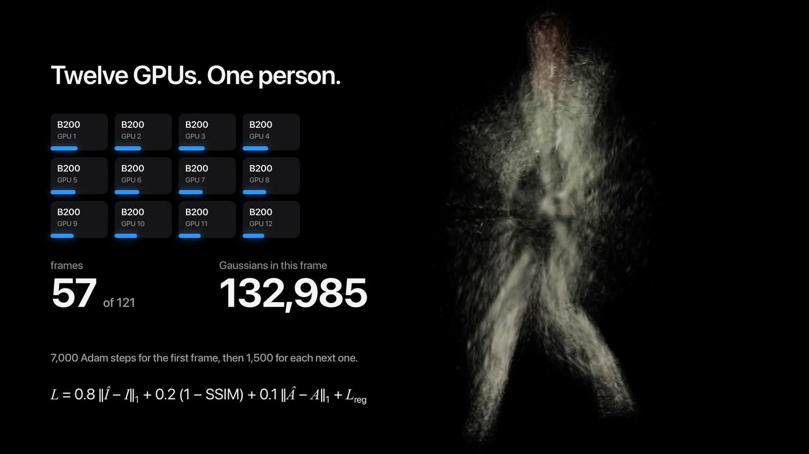
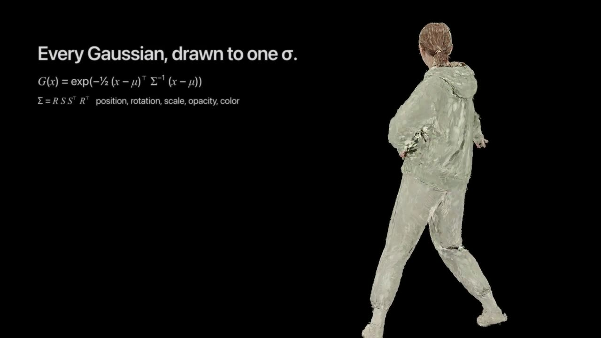
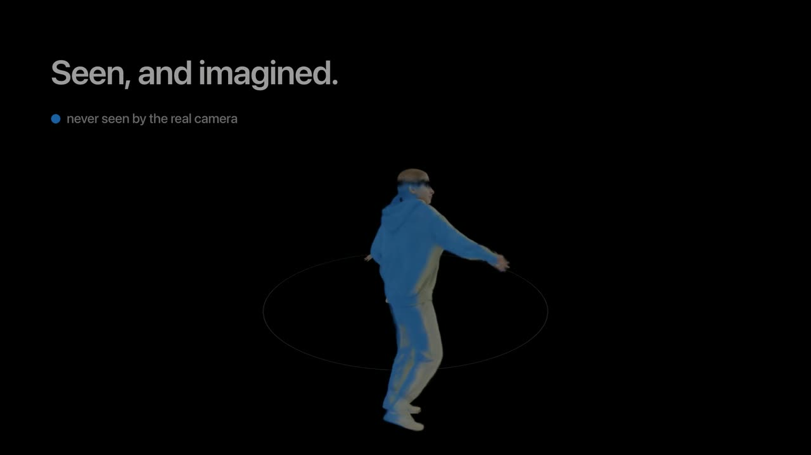

# Lucid Dreams

Turn a video or a few photos of anyone into a photoreal, life-size 3D person standing in your room, in a Meta Quest 3S.



**Website:** [getluciddreams.vercel.app](https://getluciddreams.vercel.app)
**Headset:** open [getluciddreams.vercel.app/xr](https://getluciddreams.vercel.app/xr/) in the Quest browser

Built in 48 hours at Gator Hack V (UF AI Days 2026). MIT licensed.

## What you can do

You give it a clip or a few photos, plus one sentence about what you want to do with that person.

<p>
  
  
</p>

**Learn.** A guitar video turns into a teacher sitting next to you who times every strum. Golf, dance, tai chi and a
jump shot work the same way. Lesson mode slows each step down, repeats it and then waits for your turn, and Follow along
puts glowing targets where your head and wrists should be, taken from the clip's own body joints.

**Play.** Play chess against Bobby Fischer and Magnus Carlsen at a real table. They think, reach over, move their own
pieces, press the clock and shake your hand before the game. You can also play a full tennis match against a Roger
Federer likeness with real ball physics and scoring, or shoot around with LeBron: hit your shot, pass him the ball,
and he catches it and shoots with his real release. In Court Side you stand inside a real NBA play rebuilt in 3D,
freeze it mid-air and walk around the players. Public figures are always labelled on screen ("Stockfish at Fischer's
peak rating. Not affiliated.") and never speak.



**Talk.** Vishal, built from a short phone video of him turning around, answers out loud in his own cloned voice. Ian's
grandma answers in Vietnamese with English captions. Both agreed to this, and every reply is labelled AI voice. From the
end of your question to the start of the answer takes 3.1 s (median of 11 tries).

**Reality check.** One tap turns everything the camera never saw blue and tells you how much of the person was really
seen.

## How it works

<p>
  
  
  
  
</p>

1. The browser checks the clip with MediaPipe pose (one person, head to toe) and picks the best five seconds.
2. [4DAnyone](https://github.com/ant-research/4DAnyone) turns that one video into 48 synchronized views of the person,
   three rings of 16 cameras, 121 frames at 25 fps, with every camera's pose.
3. On UF's HiPerGator, 12 NVIDIA B200s fit 3D Gaussians to every frame with [gsplat](https://github.com/nerfstudio-project/gsplat).
   The first frame takes 7,000 Adam steps; each later frame starts from the one before and takes 1,500, about a
   minute. A frame ends up with around 290,000 Gaussians. The real video frame joins as one more camera, but only where
   it agrees with the generated views.
4. Each frame is exported as SPZ (about 10x smaller than PLY) along with a Reality check copy, the 22 body joints from
   GVHMR and the real ball's path, tracked in 3D.
5. The headset app is WebXR ([three.js](https://github.com/mrdoob/three.js) and [Spark](https://github.com/sparkjsdev/spark))
   running in the Quest browser with hand tracking only. It keeps the 160,000 Gaussians per frame that matter most,
   renders at 70% resolution, and shrinks splats and skips faint ones when frames run late.

People who have to move freely (the chess players, Federer, Vishal) are avatars instead of replays. LHM++ builds a
rigged SMPL-X body from 8 to 16 photos, or from the sharpest frames of a phone video, and UIKA builds the head from a
set of photos. We render UIKA's head from 91 views and fit new, opaque Gaussians to those renders on the body's own
head, then add blinks and a 20-second idle. The browser poses them live with dual-quaternion skinning.

Your sentence and the clip become a plan, `experience.json`: the steps of a lesson, their speed and where the person
stands. Gemma 4 writes it locally through Ollama (branch [`atina/gemma-planner`](https://github.com/OjasMishra32/lucid_dreams/tree/atina/gemma-planner)), and
Gemini does the same on the bridge when it has a key. The plans in the live library were written by hand.

## Fresh off the frontier

The models at the core of Lucid Dreams came out in the last twelve months.

| Model | Public since | What it does here |
| --- | --- | --- |
| [4DAnyone](https://github.com/ant-research/4DAnyone) (Ant Research, SIGGRAPH Asia 2026) | Aug 2026 | One casual video becomes 48 consistent views all the way around a person, so a phone clip is enough to rebuild them in 3D |
| LHM++ | Mar 2026 | A rigged, animatable Gaussian body from a few photos |
| UIKA (CVPR 2026) | Jun 2026 | A head from a collection of photos |

Before 4DAnyone, rebuilding a moving person in 3D took a ring of synchronized cameras.

## Measured

Each replay against 4DAnyone's generated views (every 8th of the 48 cameras, median over the frames). The fit trained
on these views, so they are not held out. Spill is the share of the render's opacity that lands outside the person,
which is where ghosts and floaters show up.

| Replay | PSNR | SSIM | Spill | Seen by the real camera |
| --- | --- | --- | --- | --- |
| Dance | 31.9 dB | 0.982 | 0.002 | 49% |
| Tai chi | 29.6 dB | 0.973 | 0.003 | 54% |
| Jump shot | 26.7 dB | 0.967 | 0.004 | 48% |
| Golf | 26.3 dB | 0.963 | 0.004 | 47% |
| LeBron | 26.0 dB | 0.971 | 0.033 | 43% |
| Guitar | 22.0 dB | 0.96 | not measured | 59% |

- Likeness to their own photos (InsightFace ArcFace cosine, front view): Magnus 0.67, Bobby Fischer 0.53.
- Splatting cost for the jump shot at 1.8 m: 116 million shaded pixels per eye per frame with every Gaussian, 82
  million with the headset's 160,000, and 34 million at the lowest quality step.
- Talk: 3.1 s from question to answer (1.5 s to hear, 1.0 s to write, 0.5 s to speak), median of 11 tries.

## Honesty and consent

A camera never sees every side of a person, so part of every replay is generated. Reality check shows exactly which
part, and we never present generated detail as recorded.

Likenesses and voices of private people are used only with their permission: Vishal agreed to his avatar and cloned
voice, and Ian's family agreed to his grandma being shown and heard. AI replies are always labelled and never invent
memories, and none of her media is in this repository. Public figures come from their real footage or freely licensed
photos, are credited in [demo/credits.md](demo/credits.md), are labelled on screen, never speak, and are never shown
as endorsing anything.

## Run it

Each app has its own README.

**Website and job bridge** ([apps/web](apps/web)), port 5170:

```bash
npm --prefix apps/web install
npm --prefix apps/web run dev       # mock jobs and the sample dream
npm --prefix apps/web run demo      # real HiPerGator jobs through pipeline/runner
```

**Headset app** ([apps/webxr](apps/webxr)), port 5180, for the Quest browser or a laptop:

```bash
npm --prefix apps/webxr install
npm --prefix apps/webxr run dev     # https://<this computer's IP>:5180 (self-signed certificate)
```

**Talk server** ([apps/talk](apps/talk)): `node apps/talk/server.mjs`, with the OpenAI and ElevenLabs keys in
`apps/talk/.env`.

**Native Quest app** ([apps/quest](apps/quest)): Unity 6000.6 with Android Build Support. Open `apps/quest`, run
**Lucid Dreams > Set Up Project**, then **Build And Run** with the Quest plugged in.

**Pipeline** ([pipeline](pipeline)): GPU jobs run on HiPerGator, driven from a Mac with the connection:

```bash
python3 pipeline/runner/lucid_runner.py submit clip.mp4 --name "Jump shot"
python3 pipeline/runner/lucid_runner.py status <id>
python3 pipeline/runner/lucid_runner.py fetch <id>
```

**Tests:**

```bash
PYTHONPATH=pipeline python3 -m unittest discover -s pipeline/tests
cd avatars && uv run pytest
npm --prefix apps/web test
```

A small synthetic dream in [samples/synthetic-test](samples/synthetic-test) lets every player run without a GPU.

## Repository

```text
apps/web/      the website, Make a dream, and the job bridge (Next.js)
apps/webxr/    the headset app: replays, lessons, chess, tennis, Court Side, Talk (three.js + Spark)
apps/talk/     the Talk server (speech in, reply, cloned voice out)
apps/quest/    a native Quest 3S app (Unity, OpenXR)
pipeline/      reconstruction, export, ball tracking, joints, captions (Python), HiPerGator jobs, the Mac runner
avatars/       LHM++ and UIKA avatars, cleanup, blinks, skinning, hands
demo/          credits, consent, Devpost text, the demo film's scripts
docs/          plans and notes, README images
team/          one brief per teammate
AGENTS.md      the shared contracts (dream bundle, job API, experience, props) and the build log
```

## Credits

Built on [4DAnyone](https://github.com/ant-research/4DAnyone), LHM++, UIKA, [gsplat](https://github.com/nerfstudio-project/gsplat),
[Spark](https://github.com/sparkjsdev/spark), [three.js](https://github.com/mrdoob/three.js), [GVHMR](https://github.com/zju3dv/GVHMR),
[SMPL-X](https://smpl-x.is.tue.mpg.de/), MediaPipe, DDColor, Demucs, [whisper.cpp](https://github.com/ggml-org/whisper.cpp),
[Stockfish](https://github.com/official-stockfish/Stockfish), Gemma, Gemini, Whisper and ElevenLabs. Every person,
clip, photo, model and library, with its link and license (including the non-commercial and copyleft terms some carry),
is in [demo/credits.md](demo/credits.md).

## Team

Ojasva, Vishal, Ian and Atina.

## License

[MIT](LICENSE) for everything we wrote. Third-party models, code and media keep their own licenses, listed in
[demo/credits.md](demo/credits.md).
