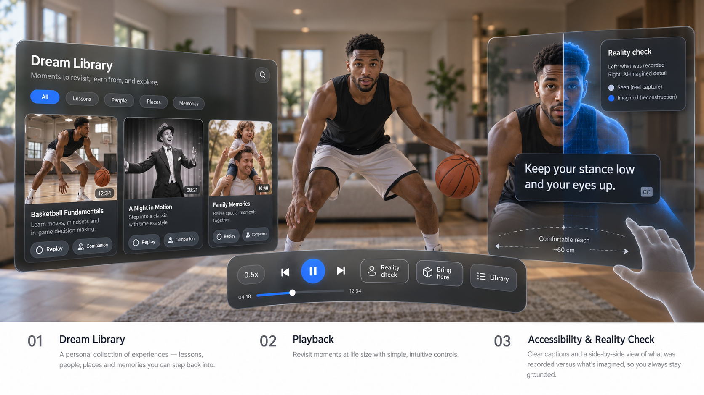

# Quest spatial UI — visual handoff

Owner: Atina. This is a visual and interaction handoff for Ian’s existing Quest implementation. It introduces no bundle, coordinate, or API change.

The image is a visual direction board, not a source of UI copy. Use the exact labels and measurements below when building. It follows Raami’s current product tokens from `apps/web/app/globals.css` and Ian’s current spatial constraints: the low control bar, chest-height captions, a reachable library, hand pinch, and a Reality check that says what was captured versus inferred.

## Calm spatial language

| Role | Token / value | Use |
| --- | --- | --- |
| Room-facing surface | `#161617` at 72% opacity | Primary panels and control rail |
| Raised control | `#1d1d1f` at 82% opacity | Buttons, cards, selected scrubber background |
| Main text | `#f5f5f7` | Titles and active control labels |
| Secondary text | `#86868b` | Metadata and descriptions |
| Divider | `rgba(255,255,255,.12)` | Hairlines only; never heavy card borders |
| Action / focus | `#0071e3` | Primary play button, selected state, keyboard/hand focus |
| Link / active text | `#2997ff` | Optional text action only |
| Reality overlay | `#2997ff` at 35–45% | The source-unseen tint; accompany it with words |
| Success / warning | `#30d158` / `#ff9f0a` | Download ready / unavailable status, never a primary action |

Use the existing system font stack, 18 mm visual corner radius (28 mm for the library container), soft 6–10 mm shadow, and a single `cubic-bezier(.2,.8,.2,1)` ease. A small amount of frosted transparency keeps the room legible. Do not use gradients, glowing outlines, dense borders, or floating decorative chrome.

## 1. Dream Library

| Item | Spatial specification | Content and behavior |
| --- | --- | --- |
| Placement | 1.20 m wide × 0.70 m high; centered 0.95 m in front of the viewer; bottom edge about 0.85 m from floor | Face the viewer on open. Keep its lower row comfortably within reach. |
| Header | 42 mm title baseline, 26 mm metadata | Title: **Dream Library**. Metadata: **Your people, moments, and lessons.** Search is optional; never hide Library behind an icon alone. |
| Card | 0.31 m × 0.42 m; 18 mm gaps; three cards across | 16:9 thumbnail, then name, kind chip, duration/availability. Images must never include source-private media unless it is cleared for the shown environment. |
| Card states | Rest, gaze/fingertip focus, selected, downloading, unavailable | Focus adds a 2 mm `#0071e3` outline and gentle 1.02 scale. Selected keeps the blue outline plus a check; it must not rely on tint alone. |
| Empty / load states | Same panel geometry | “No dreams yet” + **Make a dream**. Downloading shows percent and **Keep browsing**. Failure says what is unavailable and keeps other cards usable. |

Sort newest first, matching Ian’s current library behavior. A card opens its detail/playback view with a direct pinch; a 64 mm minimum hit target surrounds all small card actions.

## 2. Playback rail

| Item | Spatial specification | Exact control / behavior |
| --- | --- | --- |
| Placement | 0.82 m wide × 0.11 m high, 0.65 m in front of the viewer and about 0.65 m below eye line | It follows the viewer lazily but stops while a hand is near it, so it never runs away from a fingertip. |
| Primary action | Center, 72 mm circular target | **Play** / **Pause**; filled `#0071e3`, icon plus a visible label on first use and in accessibility mode. |
| Transport | 64 mm targets | **Previous**, **Next**, and a compact **Speed** button cycling **1×**, **0.5×**, **0.25×**. Do not make a long press the only way to slow playback. |
| Timeline | 13 mm visual track, 32 mm touch corridor, labelled elapsed / duration | Pinch-drag to seek; a short tick and haptic/audio cue confirm a seek. Keep it below the main controls so a hand does not cover time readout. |
| Placement | 64 mm target | **Bring here**. A 1 s long pinch invokes deliberate re-placement; a single pinch must never unexpectedly move a person. |
| Library | 64 mm target | **Library** returns to the card panel, retaining the current playback position. |
| Reality | 64 mm target | **Reality check** opens the explanation state below. It is always a labelled control, never an unlabeled eye icon. |

At the minimum bar size shown above, use a two-row wrap after five controls. Keep 18 mm gaps between targets and a 10 mm clear margin around the rail. Controls fire once per pinch release; disabled controls remain visible with an explanation, for example **No captions in this dream**.

## 3. Captions and Reality check

### Captions

Place the caption pill at roughly 60% of the person’s height, 0.42 m toward the viewer from the person. It has a maximum width of 0.56 m, at least 0.10 m height, 22 mm horizontal padding, a `#161617` 88% surface, and no pointer or decoration. Use 29 mm text with 1.18 line height, `#f5f5f7`, and **two lines maximum**. The WebVTT timing remains the authority; the UI must not delay or re-time speech.

When there are no captions, render nothing in the scene. When paused, keep the latest cue only while it is relevant and quiet; do not replace it with noisy status copy. Provide a Library/detail setting labelled **Captions** with an explicit on/off state, and a text-size option of **Standard** / **Large**. Large increases text to 36 mm while preserving two lines; if a cue cannot fit it follows the existing caption segmentation rather than shrinking below readable size.

### Reality check

The popover is a 0.36 m wide card aligned above the playback rail, never over the person’s face. Its exact title and explanation:

> **Reality check**
> **[N]% seen by the camera · blue was imagined**

Below it place one labelled toggle: **Show imagined detail**. Turning it on tints only the contract-provided source-unseen representation blue; turning it off returns to normal. The UI must show the percentage and the explanation even if the person looks unchanged, and must not claim inferred detail was recorded. If the bundle lacks this information, hide the toggle and show **Reality data is unavailable for this dream.**

## Input, comfort, and accessibility acceptance

- Every primary spatial target is at least **64 mm**; scrubbers get a larger invisible hit corridor. Keep a 18 mm gap between adjacent targets.
- Support direct pinch and controller click equivalently. Focus, press, selected, loading, and disabled states have text/icon changes in addition to color.
- Use one action per release. Provide a 120–180 ms visual confirmation and the existing Quest haptic confirmation where available.
- Never put a required instruction solely in audio. Captions must be readable against bright passthrough and must not cover eyes, hands, or the current lesson step.
- Preserve Ian’s interaction model: quick pinch for playback, 1 s long pinch for re-placement, pinch-drag for timeline and floor placement, two-hand rotate for the person.
- Test seated and standing. The rail, Library close button, Reality check, and caption setting must all be reachable without leaning farther than a relaxed forearm reach.

## Implementation sequence for Quest

1. Reuse Ian’s current playback bar and library data; apply the token values and target geometry above. Do not alter dream bundle fields, captions timing, props, or coordinate placement.
2. Add the focus/disabled/loading states and exact text labels before visual polish. Verify pinch release cannot double-trigger actions.
3. Position captions from the existing person bounds and VTT cue clock. Verify a two-line cue on a bright room background and at `0.25×` / `0.5×` / `1×`.
4. Bind the Reality check only to existing `metrics.seenFraction` and reality-frame availability. Confirm the blue overlay and percentage agree with the rendered state.
5. Capture a real-Quest walkthrough: Library → card → play/pause → seek → slow → captions → Reality check → Bring here. Review at headset distance, not only in the Unity editor.

## Handoff acceptance checklist

- [ ] Dream Library is readable at headset distance and direct-pinch targets are at least 64 mm.
- [ ] Playback rail has labelled Play/Pause, Speed, seek, Reality check, Bring here, and Library controls.
- [ ] A real VTT cue stays synchronized at all three supported speeds and remains at two lines or fewer.
- [ ] Reality check displays the actual seen fraction and the phrase “blue was imagined.”
- [ ] Focus, selected, loading, and unavailable states remain understandable without relying on color.
- [ ] A real Quest test confirms hand reach, passthrough contrast, and no accidental repeat activation.
